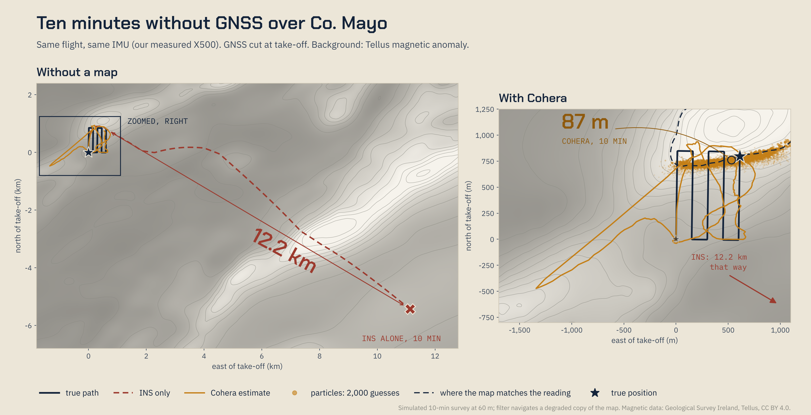

<p align="center">
  
</p>

# Cohera: quantum magnetic navigation without GNSS

**2nd place, EUDIS Defence Hackathon 2026, Dublin. Challenge 1: Navigation without GNSS.**

GNSS jamming and spoofing are now routine, and they have reached Irish-controlled
airspace. Cameras, lidar and star trackers all have conditions where they fail,
and inertial navigation on its own drifts without bound. The Earth's crust,
though, has a magnetic fingerprint: small, stable variations in field strength
from place to place that cannot be jammed or faked from a distance.

Cohera flies a magnetometer on a small drone, reads the local field, and matches
it against the Tellus airborne magnetic survey of Ireland to work out where it
is. Large aircraft already fly magnetic navigation. The hard part on a small
drone is that the sensor sits centimetres from the motors, and the drone's own
field swamps the anomaly it is trying to read. That is the problem this project
works on.

📄 **[Pitch deck (PDF)](docs/Cohera_pitch_EUDIS_2026.pdf)**

## Results

### GNSS-denied drift, bounded (simulation)



This is a 10-minute survey over Co. Mayo using the IMU noise we measured on our
own X500. With INS alone the position is **12.2 km** out after 10 minutes. With
Cohera's particle filter (2,000 hypotheses of the INS error, each scored against
the magnetic reading every 2 s) the error is **87 m**. That is about 140× less
drift. The filter navigates on a deliberately degraded copy of the map, never
the map the readings were generated from.

### Real flights: getting the sensor away from the drone

We built and flew a Holybro X500 V2 running ArduCopter with DroneCAN RM3100
magnetometers. These stand in for the QuSpin QTFM optically pumped magnetometer
a deployed system would carry. During the event we went from a sensor on the
frame to a 70 cm boom, flying autonomous survey patterns with every motor's RPM
logged alongside the field:

| Mount | Sensor to nearest motor | Platform interference |
|---|---|---|
| V1, on the frame | 17 cm | 538 nT |
| V2, first boom | 30 cm | 300 nT |
| V3, longer boom | 70 cm | 153 nT |

The map signal we need to read is 28–100 nT. Raw CAN logging took the
magnetometer stream from 10 Hz with 100 nT steps to 25 Hz with ~12–24 nT steps.


## Repository layout

```
modelling/   Python package: Tellus map sampling, strapdown INS, magnetometer
             emulation, error-state particle filter, notebooks and tests
hardware/    Airframe build notes, ArduPilot parameters, mission plans and
             every flight log (.bin) from the event
docs/        Pitch deck and figures
```

[`modelling/README.md`](modelling/README.md) has the full technical write-up.
[`hardware/README.md`](hardware/README.md) covers the build and the flight logs.

## Quick start

```bash
python3 -m venv .venv
source .venv/bin/activate
pip install -e "./modelling[dev]"

cd modelling
python scripts/fetch_tellus.py     # Tellus block A7, ~93 MB
pytest
python scripts/run_pf_demo.py      # INS alone vs INS + magnetic matching
```

## Team

- **Peter Dunniece**: quantum
- **Lorcan Grimes**: aerospace
- **Alexander O'Sullivan**: mechanical

## Data and attribution

Contains Irish Public Sector Data (Geological Survey Ireland) licensed under a
Creative Commons Attribution 4.0 International (CC BY 4.0) licence. The national
merged grid also covers Northern Ireland and contains data from the Geological
Survey of Northern Ireland under the Open Government Licence v3.0.

Satellite imagery in figures: Esri, Maxar, Earthstar Geographics.
