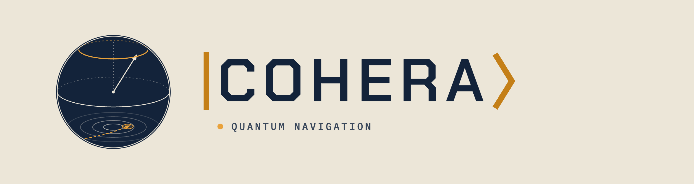
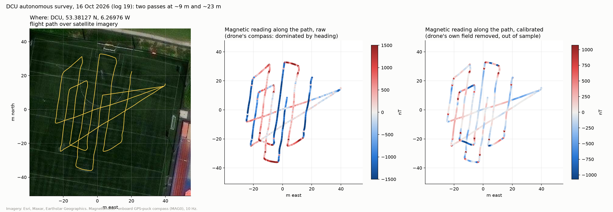

<p align="center">
  
</p>

# Cohera - 2nd Place (€6000) -  Application only Event 

**2nd place, EUDIS Defence Hackathon 2026, Dublin. Challenge 1: Navigation without GNSS.**

GNSS-free drone navigation by magnetic anomaly matching. A magnetometer on the
drone reads the local field, and a particle filter matches it against the Tellus
airborne magnetic survey of Ireland to estimate position.

In a simulated 10-minute flight using our drone's measured IMU, position error
fell from 12.2 km with the IMU alone to 87 m with map matching.

**[Pitch deck (PDF)](docs/Cohera_pitch_EUDIS_2026.pdf)**



## Repository

- **`modelling/`**: map sampling, strapdown INS, magnetometer emulation, the
  particle filter, notebooks and tests. See [`modelling/README.md`](modelling/README.md).
- **`hardware/`**: the X500 build, ArduPilot parameters and all flight logs. See
  [`hardware/README.md`](hardware/README.md).
- **`docs/`**: the pitch deck and figures.

```bash
python3 -m venv .venv && source .venv/bin/activate
pip install -e "./modelling[dev]"
cd modelling && python scripts/fetch_tellus.py && pytest
```

## Team

Peter Dunniece · Lorcan Grimes · Alexander O'Sullivan

## Attribution

Contains Irish Public Sector Data (Geological Survey Ireland) licensed under
CC BY 4.0, and Geological Survey of Northern Ireland data under OGL v3.0.
